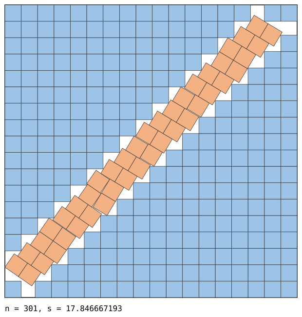
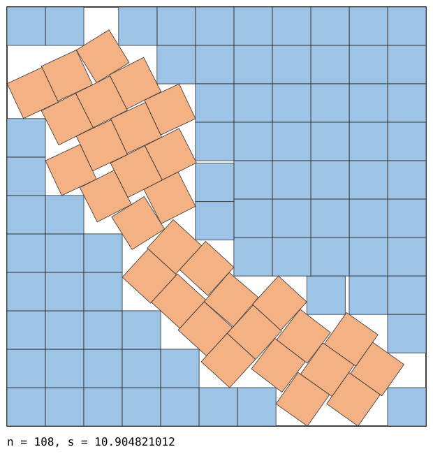
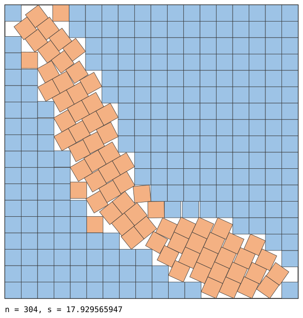
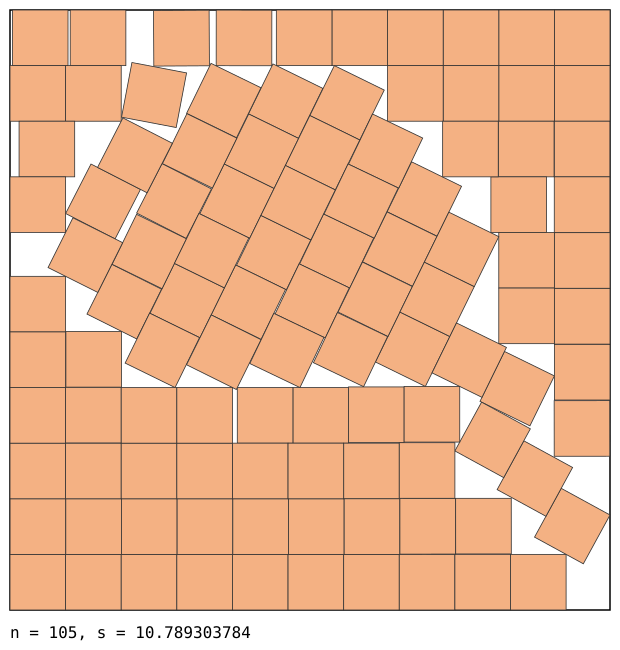
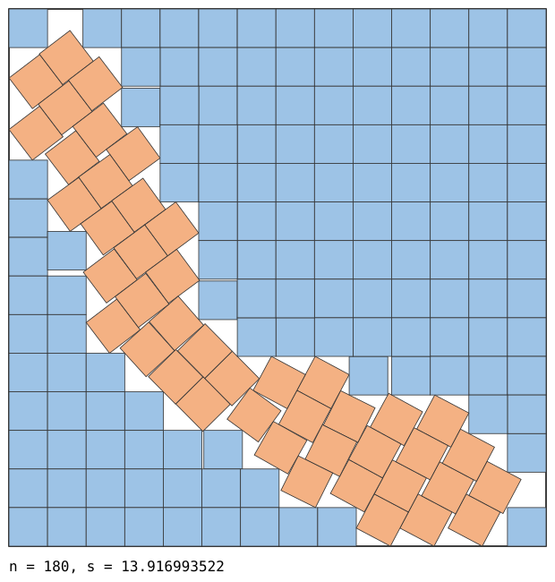

# Square packings better than the published records

Packings of `n` unit squares in a square of side `s`, each smaller than the best
known value in the [Friedman/Ellsworth catalogue](https://kingbird.myphotos.cc/packing/squares_in_squares.html)
(fetched 2026-09-25).

| n | previous best known | found here | improvement |
|---|---|---|---|
| 68 | 8.7987961402601 | **8.798795237220** | 9.030e-07 |
| 84 | 9.70710678118654 | **9.697934799017** | 9.172e-03 |
| 86 | 9.82287565553229 | **9.820535407499** | 2.340e-03 |
| 105 | 10.80761933330707 | **10.789303783750** | 1.832e-02 |
| 106 | 10.82297973416944 | **10.822908044135** | 7.169e-05 |
| 108 | 10.92591939016138 | **10.904821012322** | 2.110e-02 |
| 110 | 10.99679327401957 | **10.996783396634** | 9.877e-06 |
| 127 | 11.82287565553229 | **11.810878787591** | 1.200e-02 |
| 131 | 11.95652543280926 | **11.951105389417** | 5.420e-03 |
| 132 | 11.99137344423646 | **11.986953587257** | 4.420e-03 |
| 152 | 12.83095954472600 | **12.830718800979** | 2.407e-04 |
| 154 | 12.93166712962655 | **12.922499814645** | 9.167e-03 |
| 155 | 12.95844711161529 | **12.952498944016** | 5.948e-03 |
| 156 | 12.98208376048414 | **12.979165853837** | 2.918e-03 |
| 172 | 13.61898898660160 | **13.618988956902** | 2.970e-08 |
| 175 | 13.77817459305202 | **13.767119024201** | 1.106e-02 |
| 176 | 13.82287565553229 | **13.807637226805** | 1.524e-02 |
| 177 | 13.82302875075647 | **13.822979734172** | 4.902e-05 |
| 180 | 13.93508705291129 | **13.916993522480** | 1.809e-02 |
| 181 | 13.95690672341755 | **13.953748821957** | 3.158e-03 |
| 182 | 13.97419105332569 | **13.974090713124** | 1.003e-04 |
| 206 | 14.87221902560728 | **14.860158663395** | 1.206e-02 |
| 208 | 14.93776656277905 | **14.924518772032** | 1.325e-02 |
| 209 | 14.95861500087481 | **14.946223226449** | 1.239e-02 |
| 210 | 14.97413341886404 | **14.973001116590** | 1.132e-03 |
| 211 | 15 | **14.993558913983** | 6.441e-03 |
| 228 | 15.60902282132495 | **15.604601475733** | 4.421e-03 |
| 237 | 15.91421356237309 | **15.902947773661** | 1.127e-02 |
| 240 | 15.97556282833087 | **15.969685337534** | 5.877e-03 |
| 241 | 15.99080517810520 | **15.987117095154** | 3.688e-03 |
| 259 | 16.60257141234448 | **16.602568490497** | 2.922e-06 |
| 263 | 16.74264068711928 | **16.740412653803** | 2.228e-03 |
| 267 | 16.84666719284348 | **16.838815269951** | 7.852e-03 |
| 268 | 16.87931143465371 | **16.878814821010** | 4.966e-04 |
| 269 | 16.90596764828402 | **16.905967058587** | 5.897e-07 |
| 270 | 16.94062059800744 | **16.929775353545** | 1.085e-02 |
| 271 | 16.95499909412532 | **16.948992356454** | 6.007e-03 |
| 273 | 16.98820725030513 | **16.983925962654** | 4.281e-03 |
| 292 | 17.60257141234448 | **17.597249391200** | 5.322e-03 |
| 297 | 17.74106074604732 | **17.740417287547** | 6.435e-04 |
| 301 | 17.86889155557430 | **17.846667192847** | 2.222e-02 |
| 302 | 17.88674602860566 | **17.870013850408** | 1.673e-02 |
| 303 | 17.93125509556197 | **17.917365675356** | 1.389e-02 |
| 304 | 17.94910783564662 | **17.929565946852** | 1.954e-02 |
| 305 | 17.96066201401205 | **17.950466482141** | 1.020e-02 |
| 306 | 17.96913960675661 | **17.963433717495** | 5.706e-03 |
| 307 | 17.98272201579610 | **17.981030548637** | 1.691e-03 |
| 308 | 18 | **17.998459831027** | 1.540e-03 |

<!-- current-status -->

## Standing against the current register

The table above compares with the catalogue as fetched in September. Against the [jlevy/squares register](https://jlevy.github.io/squares/) and verified pending submissions by others (`known_best.json`, refreshed 2026-10-13): 7 best known, 16 registered, 10 tied, 15 superseded.

| n | found here | best known elsewhere | source | status |
|---|---|---|---|---|
| 68 | 8.798795237220 | 8.798795237218 | register | **registered** (exact optimum by Seth Rehwaldt) |
| 84 | 9.697934799017 (seeded from Ryan Xu) | 9.697934799015 | register | tied (rounding) (same packing also in [#470](https://github.com/jlevy/squares/issues/470)) |
| 86 | 9.820535407499 (seeded from Ryan Xu) | 9.820535407497 | register | tied (rounding) (same packing also in [#470](https://github.com/jlevy/squares/issues/470)) |
| 105 | 10.789303783750 (seeded from Ryan Xu) | 10.789303783748 | register | tied (rounding) (same packing also in [#503](https://github.com/jlevy/squares/issues/503), [#470](https://github.com/jlevy/squares/issues/470)) |
| 106 | 10.822908044135 | 10.822908044133 | register | **registered** (exact optimum by Evan Daniel) |
| 108 | 10.904821012322 (seeded from Ryan Xu) | 10.904821012320 | register | tied (rounding) (same packing also in [#470](https://github.com/jlevy/squares/issues/470)) |
| 110 | 10.996783396634 | 10.996783396632 | register | **registered** (exact optimum by Evan Daniel) |
| 127 | 11.810878787591 (seeded from Ryan Xu) | 11.810878787589 | register | tied (rounding) |
| 131 | 11.951105389417 (seeded from Ryan Xu) | 11.949659588036 | register | superseded by 1.4e-03 |
| 132 | 11.986953587257 (seeded from Mishapolk) | 11.985680198846 | register | superseded by 1.3e-03 |
| 152 | 12.830718800979 | 12.830718800977 | register | **registered** (exact optimum by Evan Daniel) |
| 154 | 12.922499814645 (seeded from Evan Daniel (from Francisco Couzo's n=155 seed)) | 12.922566401934 | [Evan Daniel (from Francisco Couzo's n=155 seed)](https://github.com/jlevy/squares/issues/552) (pending) | **best known** |
| 155 | 12.952498944016 (seeded from Nate Chaoweeraprasit (SQUISH)) | 12.952425406958 | register | superseded by 7.4e-05 (same packing also in [#465](https://github.com/jlevy/squares/issues/465)) |
| 156 | 12.979165853837 (seeded from Daniil Ostashev) | 12.979172613644 | register | **best known** |
| 172 | 13.618988956902 | 13.618988956899 | register | **registered** (exact optimum by Evan Daniel) |
| 175 | 13.767119024201 (seeded from Ryan Xu) | 13.764174317501 | [Mishapolk](https://github.com/jlevy/squares/issues/470) (pending) | superseded by 2.9e-03 |
| 176 | 13.807637226805 (seeded from Daniil Ostashev) | 13.795872318436 | [Daniil Ostashev](https://github.com/jlevy/squares/issues/501) (pending) | superseded by 1.2e-02 |
| 177 | 13.822979734172 | 13.822979734169 | register | **registered** (exact optimum by Evan Daniel) |
| 180 | 13.916993522480 (seeded from Nate Chaoweeraprasit (SQUISH), precision-refined by SidG2k1) | 13.916993522478 | register | tied (rounding) |
| 181 | 13.953748821957 | 13.950819531023 | register | superseded by 2.9e-03 |
| 182 | 13.974090713124 | 13.974090713121 | register | **registered** (exact optimum by Evan Daniel) |
| 206 | 14.860158663395 | 14.860158663392 | register | **registered** (exact optimum by Evan Daniel) |
| 208 | 14.924518772032 | 14.924518772029 | register | tied (rounding) (same packing also in [#438](https://github.com/jlevy/squares/issues/438), [#422](https://github.com/jlevy/squares/issues/422), [#470](https://github.com/jlevy/squares/issues/470)) |
| 209 | 14.946223226449 (seeded from Nate Chaoweeraprasit (SQUISH)) | 14.946223226446 | register | tied (rounding) (same packing also in [#470](https://github.com/jlevy/squares/issues/470)) |
| 210 | 14.973001116590 | 14.973001116588 | register | **registered** (exact optimum by Evan Daniel) |
| 211 | 14.993558913983 (seeded from Daniil Ostashev) | 14.993694186583 | [Daniil Ostashev](https://github.com/jlevy/squares/issues/501) (pending) | **best known** |
| 228 | 15.604601475733 | 15.604601475730 | register | **registered** |
| 237 | 15.902947773661 (seeded from Nate Chaoweeraprasit (SQUISH)) | 15.902949607678 | register | **best known** |
| 240 | 15.969685337534 | 15.969685337531 | register | **registered** (exact optimum by Evan Daniel) |
| 241 | 15.987117095154 (seeded from Daniil Ostashev) | 15.987134249051 | [Daniil Ostashev](https://github.com/jlevy/squares/issues/501) (pending) | **best known** |
| 259 | 16.602568490497 | 16.591378145498 | register | superseded by 1.1e-02 |
| 263 | 16.740412653803 (seeded from Nate Chaoweeraprasit (SQUISH)) | 16.733166007899 | register | superseded by 7.2e-03 |
| 267 | 16.838815269951 (seeded from Ryan Xu) | 16.838815269948 | register | tied (rounding) (same packing also in [#470](https://github.com/jlevy/squares/issues/470)) |
| 268 | 16.878814821010 | 16.878814821007 | register | **registered** (exact optimum by Evan Daniel) |
| 269 | 16.905967058587 | 16.901513582189 | register | superseded by 4.5e-03 |
| 270 | 16.929775353545 (seeded from Nate Chaoweeraprasit (SQUISH)) | 16.928196993329 | register | superseded by 1.6e-03 (same packing also in [#470](https://github.com/jlevy/squares/issues/470)) |
| 271 | 16.948992356454 (seeded from Nate Chaoweeraprasit (SQUISH)) | 16.949116687815 | register | **best known** |
| 273 | 16.983925962654 | 16.983925962650 | register | **registered** (exact optimum by Evan Daniel) |
| 292 | 17.597249391200 | 17.591378145498 | register | superseded by 5.9e-03 |
| 297 | 17.740417287547 | 17.740417287544 | register | **registered** (exact optimum by Evan Daniel) |
| 301 | 17.846667192847 | 17.846667192843 | register | **registered** (exact optimum by Evan Daniel) |
| 302 | 17.870013850408 (seeded from BuddenPing) | 17.870275382734 | [BuddenPing](https://github.com/jlevy/squares/issues/503) (pending) | **best known** |
| 303 | 17.917365675356 (seeded from Nate Chaoweeraprasit (SQUISH)) | 17.909958291070 | [Daniil Ostashev](https://github.com/jlevy/squares/issues/501) (pending) | superseded by 7.4e-03 |
| 304 | 17.929565946852 (seeded from Nate Chaoweeraprasit (SQUISH)) | 17.929427758075 | [Daniil Ostashev](https://github.com/jlevy/squares/issues/501) (pending) | superseded by 1.4e-04 |
| 305 | 17.950466482141 (seeded from Nate Chaoweeraprasit (SQUISH)) | 17.950466482138 | register | tied (rounding) |
| 306 | 17.963433717495 | 17.963433717491 | register | **registered** (same packing also in [#470](https://github.com/jlevy/squares/issues/470)) |
| 307 | 17.981030548637 | 17.980862784055 | register | superseded by 1.7e-04 |
| 308 | 17.998459831027 (seeded from Kevin Fang (TheSnakeFang)) | 17.998269879526 | register | superseded by 1.9e-04 |

<!-- /current-status -->

<!-- expanded-search-results -->

Searches also cover n=325–400. The derived reference bounds remain the frozen L-border/grid comparisons. Published bounds come from the verified sources in `known_best.json`; their values below are rounded upward. Reviewed published comparisons cover 6 of these 25 counts as of 2026-10-13. A dash means no published comparison was established in the reviewed sources. Source revisions and certificate links are recorded in [known_best.json](known_best.json).

| n | derived reference bound | found here (numerical) | improvement over reference | verified published bound | published source | standing |
|---|---|---|---|---|---|---|
| 327 | 18.60257141234448 | **18.597249391205** | 5.322e-03 | — | — | reference comparison only |
| 332 | 18.74106074604732 | **18.740417287547** | 6.435e-04 | — | — | reference comparison only |
| 335 | 18.82412338847854 | **18.822875655544** | 1.248e-03 | — | — | reference comparison only |
| 336 | 18.86889155557430 | **18.825571499865** | 4.332e-02 | — | — | reference comparison only |
| 337 | 18.88674602860566 | **18.858391767640** | 2.835e-02 | — | — | reference comparison only |
| 338 | 18.93125509556197 | **18.906332809856** | 2.492e-02 | — | — | reference comparison only |
| 339 | 18.94910783564662 | **18.927383638315** | 2.172e-02 | — | — | reference comparison only |
| 340 | 18.96066201401205 | **18.939649632895** | 2.101e-02 | — | — | reference comparison only |
| 341 | 18.96913960675661 | **18.951882408724** | 1.726e-02 | — | — | reference comparison only |
| 342 | 18.98272201579610 | **18.964706723440** | 1.802e-02 | — | — | reference comparison only |
| 343 | 19 | **18.993870589753** | 6.129e-03 | 18.978232523636 | [Evan Daniel (after Kevin Fang)](https://github.com/jlevy/squares/issues/489) | superseded by 1.6e-02 |
| 344 | 19 | **18.993724773107** | 6.275e-03 | 18.994450514278 | [Evan Daniel (after Kevin Fang)](https://github.com/jlevy/squares/issues/489) | **smaller than reviewed published bound** |
| 364 | 19.60257141234448 | **19.597249391207** | 5.322e-03 | — | — | reference comparison only |
| 369 | 19.74106074604732 | **19.740417287548** | 6.435e-04 | — | — | reference comparison only |
| 372 | 19.82412338847854 | **19.822875655617** | 1.248e-03 | — | — | reference comparison only |
| 373 | 19.86889155557430 | **19.823062082842** | 4.583e-02 | — | — | reference comparison only |
| 374 | 19.88674602860566 | **19.832356217037** | 5.439e-02 | — | — | reference comparison only |
| 375 | 19.93125509556197 | **19.893906534239** | 3.735e-02 | 19.906981767291 | [Evan Daniel (from a Francisco Couzo seed)](https://github.com/evand/square-packing/blob/31523f87316bdfda00f5459dd9077928e264f133/search/packer/PACKER.md#L957-L988) | **smaller than reviewed published bound** |
| 376 | 19.94910783564662 | **19.904068025750** | 4.504e-02 | — | — | reference comparison only |
| 377 | 19.96066201401205 | **19.925720814334** | 3.494e-02 | — | — | reference comparison only |
| 378 | 19.96913960675661 | **19.942519693857** | 2.662e-02 | — | — | reference comparison only |
| 379 | 19.98272201579610 | **19.953531531606** | 2.919e-02 | — | — | reference comparison only |
| 380 | 20 | **19.973553604730** | 2.645e-02 | 19.976775433975 | [Kevin Fang (TheSnakeFang)](https://github.com/jlevy/squares/issues/484) | **smaller than reviewed published bound** |
| 381 | 20 | **19.974977397661** | 2.502e-02 | 19.976969740406 | [Kevin Fang (TheSnakeFang)](https://github.com/jlevy/squares/issues/484) | **smaller than reviewed published bound** |
| 382 | 20 | **19.988600566389** | 1.140e-02 | 19.989479729400 | [Kevin Fang (TheSnakeFang)](https://github.com/jlevy/squares/issues/484) | **smaller than reviewed published bound** |

<!-- /expanded-search-results -->
