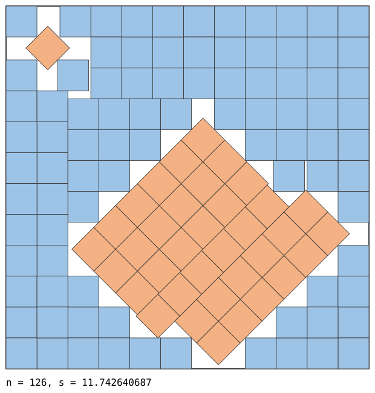
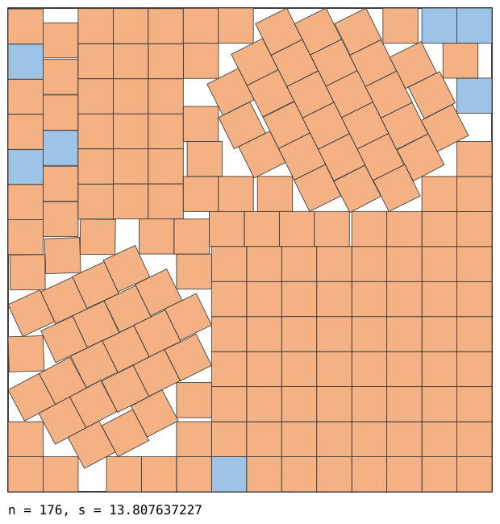
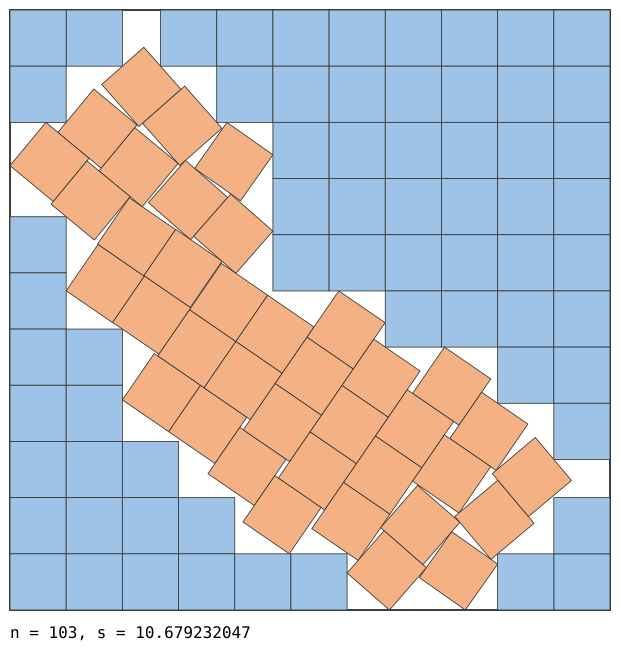
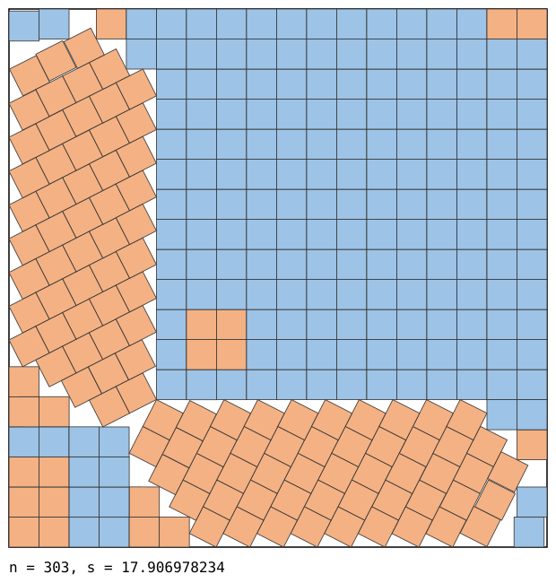

# Record square packings

Current record packings of `n` unit squares in a square of side `s`. Superseded
packings are retained in Git history and as private search seeds. The first table
compares against the [Friedman/Ellsworth catalogue](https://kingbird.myphotos.cc/packing/squares_in_squares.html)
(fetched 2026-09-25).

[Upper bounds](upper_bounds.json) and [lower bounds](lower_bounds.json) cover every
count through n=1024. Exact certificate bounds, frozen reference comparisons,
and reported lower-bound or optimality claims retain their source and verification
status. The [closed-form lower-bound parameters](lower_bound_families.json) can be
evaluated with `lower_bounds.py`; evaluating the formula does not replay its proof.

| n | previous best known | found here | improvement |
|---|---|---|---|
| 51 | 7.70079923541701 | **7.690355937290** | 1.044e-02 |
| 68 | 8.7987961402601 | **8.798795237220** | 9.030e-07 |
| 70 | 8.88166675700900 | **8.880960371557** | 7.064e-04 |
| 84 | 9.70710678118654 | **9.697934799017** | 9.172e-03 |
| 86 | 9.82287565553229 | **9.820535407499** | 2.340e-03 |
| 88 | 9.88815305375857 | **9.882451030483** | 5.702e-03 |
| 102 | 10.61138794077522 | **10.605828696434** | 5.559e-03 |
| 103 | 10.70378195534367 | **10.679232047363** | 2.455e-02 |
| 105 | 10.80761933330707 | **10.789303783750** | 1.832e-02 |
| 106 | 10.82297973416944 | **10.822908044135** | 7.169e-05 |
| 108 | 10.92591939016138 | **10.904821012322** | 2.110e-02 |
| 110 | 10.99679327401957 | **10.996783396634** | 9.877e-06 |
| 123 | 11.60139979378801 | **11.591378145500** | 1.002e-02 |
| 126 | 11.77473513240654 | **11.742640687121** | 3.209e-02 |
| 127 | 11.82287565553229 | **11.810878787591** | 1.200e-02 |
| 129 | 11.88130621809000 | **11.870013850407** | 1.129e-02 |
| 130 | 11.91119052015898 | **11.904483032518** | 6.707e-03 |
| 131 | 11.95652543280926 | **11.949659588038** | 6.866e-03 |
| 132 | 11.99137344423646 | **11.985680198848** | 5.693e-03 |
| 146 | 12.60090777851301 | **12.583782190154** | 1.713e-02 |
| 152 | 12.83095954472600 | **12.830718800979** | 2.407e-04 |
| 153 | 12.88166675700900 | **12.870013850407** | 1.165e-02 |
| 154 | 12.93166712962655 | **12.921206577135** | 1.046e-02 |
| 155 | 12.95844711161529 | **12.952260944653** | 6.186e-03 |
| 156 | 12.98208376048414 | **12.979165853837** | 2.918e-03 |
| 172 | 13.61898898660160 | **13.618988956902** | 2.970e-08 |
| 175 | 13.77817459305202 | **13.764174317489** | 1.400e-02 |
| 176 | 13.82287565553229 | **13.795872318439** | 2.700e-02 |
| 177 | 13.82302875075647 | **13.822979734172** | 4.902e-05 |
| 179 | 13.89534106997649 | **13.883795490513** | 1.155e-02 |
| 180 | 13.93508705291129 | **13.916993522480** | 1.809e-02 |
| 181 | 13.95690672341755 | **13.950819531026** | 6.087e-03 |
| 182 | 13.97419105332569 | **13.974090713124** | 1.003e-04 |
| 199 | 14.61898898660160 | **14.617572173596** | 1.417e-03 |
| 204 | 14.82287565553229 | **14.808644416309** | 1.423e-02 |
| 206 | 14.87221902560728 | **14.860158663395** | 1.206e-02 |
| 207 | 14.89395494255333 | **14.880960371558** | 1.299e-02 |
| 208 | 14.93776656277905 | **14.924518772032** | 1.325e-02 |
| 209 | 14.95861500087481 | **14.946223226449** | 1.239e-02 |
| 210 | 14.97413341886404 | **14.973001116590** | 1.132e-03 |
| 211 | 15 | **14.993549626302** | 6.450e-03 |
| 227 | 15.57106781186547 | **15.563796701672** | 7.271e-03 |
| 228 | 15.60902282132495 | **15.604601475733** | 4.421e-03 |
| 229 | 15.65685424949238 | **15.650174754951** | 6.679e-03 |
| 232 | 15.77817459305202 | **15.764174317490** | 1.400e-02 |
| 236 | 15.87607539315201 | **15.861934390610** | 1.414e-02 |
| 237 | 15.91421356237309 | **15.902603638263** | 1.161e-02 |
| 238 | 15.93965520031394 | **15.924106785325** | 1.555e-02 |
| 239 | 15.95635358406308 | **15.948443327304** | 7.910e-03 |
| 240 | 15.97556282833087 | **15.969685337534** | 5.877e-03 |
| 241 | 15.99080517810520 | **15.987117095153** | 3.688e-03 |
| 258 | 16.57106781186547 | **16.563448002137** | 7.620e-03 |
| 259 | 16.60257141234448 | **16.591378145501** | 1.119e-02 |
| 260 | 16.65685424949238 | **16.645778802185** | 1.108e-02 |
| 261 | 16.68292682926829 | **16.678779875346** | 4.147e-03 |
| 263 | 16.74264068711928 | **16.733166007903** | 9.475e-03 |
| 264 | 16.77817459305202 | **16.774735132391** | 3.439e-03 |
| 266 | 16.82306208283780 | **16.823028750760** | 3.333e-05 |
| 267 | 16.84666719284348 | **16.838815269951** | 7.852e-03 |
| 268 | 16.87931143465371 | **16.878814821010** | 4.966e-04 |
| 269 | 16.90596764828402 | **16.901513582192** | 4.454e-03 |
| 270 | 16.94062059800744 | **16.928196993332** | 1.242e-02 |
| 271 | 16.95499909412532 | **16.948947733717** | 6.051e-03 |
| 272 | 16.96971602419903 | **16.965586474841** | 4.130e-03 |
| 273 | 16.98820725030513 | **16.983925962654** | 4.281e-03 |
| 292 | 17.60257141234448 | **17.591378145501** | 1.119e-02 |
| 295 | 17.70710678118654 | **17.704232790739** | 2.874e-03 |
| 297 | 17.74106074604732 | **17.740417287547** | 6.435e-04 |
| 301 | 17.86889155557430 | **17.846667192847** | 2.222e-02 |
| 302 | 17.88674602860566 | **17.870013850408** | 1.673e-02 |
| 303 | 17.93125509556197 | **17.909958291073** | 2.130e-02 |
| 304 | 17.94910783564662 | **17.929427758079** | 1.968e-02 |
| 305 | 17.96066201401205 | **17.950466482141** | 1.020e-02 |
| 306 | 17.96913960675661 | **17.963433717495** | 5.706e-03 |
| 307 | 17.98272201579610 | **17.980862784058** | 1.859e-03 |
| 308 | 18 | **17.998269879530** | 1.730e-03 |

<!-- current-status -->

## Standing against the current register

The table above compares with the catalogue as fetched in September. Against the [jlevy/squares register](https://jlevy.github.io/squares/) and verified pending submissions by others (`known_best.json`, refreshed 2026-10-17): 4 best known, 72 tied.

| n | found here | best known elsewhere | source | status |
|---|---|---|---|---|
| 51 | 7.690355937290 (seeded from PingYou Ltd (BuddenPing)) | 7.690355937288 | register | tied (rounding) (same packing also in [#432](https://github.com/jlevy/squares/issues/432), [#593](https://github.com/jlevy/squares/issues/593)) |
| 68 | 8.798795237220 | 8.798795237218 | register | tied (rounding) |
| 70 | 8.880960371557 (seeded from PingYou Ltd (BuddenPing)) | 8.880960371556 | register | tied (rounding) (same packing also in [#432](https://github.com/jlevy/squares/issues/432), [#593](https://github.com/jlevy/squares/issues/593), [#483](https://github.com/jlevy/squares/issues/483)) |
| 84 | 9.697934799017 (seeded from Ryan Xu) | 9.697934799015 | register | tied (rounding) (same packing also in [#470](https://github.com/jlevy/squares/issues/470)) |
| 86 | 9.820535407499 (seeded from Ryan Xu) | 9.820535407497 | register | tied (rounding) (same packing also in [#593](https://github.com/jlevy/squares/issues/593), [#470](https://github.com/jlevy/squares/issues/470)) |
| 88 | 9.882451030483 (seeded from PingYou Ltd (BuddenPing)) | 9.882451030481 | register | tied (rounding) (same packing also in [#401](https://github.com/jlevy/squares/issues/401), [#593](https://github.com/jlevy/squares/issues/593)) |
| 102 | 10.605828696434 (seeded from PingYou Ltd (BuddenPing)) | 10.605828696432 | register | tied (rounding) (same packing also in [#432](https://github.com/jlevy/squares/issues/432), [#593](https://github.com/jlevy/squares/issues/593)) |
| 103 | 10.679232047363 (seeded from PingYou Ltd (BuddenPing)) | 10.679232047361 | register | tied (rounding) (same packing also in [#432](https://github.com/jlevy/squares/issues/432), [#593](https://github.com/jlevy/squares/issues/593), [#470](https://github.com/jlevy/squares/issues/470)) |
| 105 | 10.789303783750 (seeded from Ryan Xu) | 10.789303783748 | register | tied (rounding) (same packing also in [#503](https://github.com/jlevy/squares/issues/503), [#593](https://github.com/jlevy/squares/issues/593), [#470](https://github.com/jlevy/squares/issues/470)) |
| 106 | 10.822908044135 | 10.822908044133 | register | tied (rounding) |
| 108 | 10.904821012322 (seeded from Ryan Xu) | 10.904821012320 | register | tied (rounding) (same packing also in [#451](https://github.com/jlevy/squares/issues/451), [#593](https://github.com/jlevy/squares/issues/593), [#470](https://github.com/jlevy/squares/issues/470)) |
| 110 | 10.996783396634 | 10.996783396632 | register | tied (rounding) (same packing also in [#593](https://github.com/jlevy/squares/issues/593)) |
| 123 | 11.591378145500 (seeded from PingYou Ltd (BuddenPing)) | 11.591378145498 | register | tied (rounding) (same packing also in [#432](https://github.com/jlevy/squares/issues/432), [#593](https://github.com/jlevy/squares/issues/593)) |
| 126 | 11.742640687121 (seeded from PingYou Ltd (BuddenPing)) | 11.742640687119 | register | tied (rounding) (same packing also in [#432](https://github.com/jlevy/squares/issues/432), [#593](https://github.com/jlevy/squares/issues/593)) |
| 127 | 11.810878787591 (seeded from Ryan Xu) | 11.810878787589 | register | tied (rounding) (same packing also in [#593](https://github.com/jlevy/squares/issues/593)) |
| 129 | 11.870013850407 (seeded from Mykhailo Polkovskyi (Mishapolk)) | 11.870013850404 | register | tied (rounding) (same packing also in [#593](https://github.com/jlevy/squares/issues/593), [#470](https://github.com/jlevy/squares/issues/470), [#562](https://github.com/jlevy/squares/issues/562)) |
| 130 | 11.904483032518 (seeded from PingYou Ltd (BuddenPing)) | 11.904483032516 | register | tied (rounding) (same packing also in [#401](https://github.com/jlevy/squares/issues/401), [#593](https://github.com/jlevy/squares/issues/593), [#438](https://github.com/jlevy/squares/issues/438), [#470](https://github.com/jlevy/squares/issues/470)) |
| 131 | 11.949659588038 (seeded from PingYou Ltd (BuddenPing)) | 11.949659588036 | register | tied (rounding) (same packing also in [#481](https://github.com/jlevy/squares/issues/481), [#593](https://github.com/jlevy/squares/issues/593)) |
| 132 | 11.985680198848 (seeded from PingYou Ltd (BuddenPing)) | 11.985680198846 | register | tied (rounding) (same packing also in [#489](https://github.com/jlevy/squares/issues/489), [#593](https://github.com/jlevy/squares/issues/593)) |
| 146 | 12.583782190154 (seeded from Evan Daniel) | 12.583782190152 | register | tied (rounding) (same packing also in [#399](https://github.com/jlevy/squares/issues/399)) |
| 152 | 12.830718800979 | 12.830718800977 | register | tied (rounding) |
| 153 | 12.870013850407 (seeded from Mykhailo Polkovskyi (Mishapolk)) | 12.870013850404 | register | tied (rounding) |
| 154 | 12.921206577135 (seeded from Evan Daniel (from Francisco Couzo's n=155 seed)) | 12.921206577133 | register | tied (rounding) (same packing also in [#593](https://github.com/jlevy/squares/issues/593), [#470](https://github.com/jlevy/squares/issues/470)) |
| 155 | 12.952260944653 (seeded from Evan Daniel) | 12.952260944651 | [Evan Daniel](https://github.com/jlevy/squares/issues/669) (pending) | tied (rounding) (same packing also in [#593](https://github.com/jlevy/squares/issues/593), [#501](https://github.com/jlevy/squares/issues/501), [#465](https://github.com/jlevy/squares/issues/465)) |
| 156 | 12.979165853837 (seeded from Daniil Ostashev) | 12.979165853834 | register | tied (rounding) (same packing also in [#593](https://github.com/jlevy/squares/issues/593), [#470](https://github.com/jlevy/squares/issues/470)) |
| 172 | 13.618988956902 | 13.618988956899 | register | tied (rounding) |
| 175 | 13.764174317489 (seeded from Mykhailo Polkovskyi (Mishapolk)) | 13.764174317487 | register | tied (rounding) (same packing also in [#593](https://github.com/jlevy/squares/issues/593), [#470](https://github.com/jlevy/squares/issues/470), [#528](https://github.com/jlevy/squares/issues/528)) |
| 176 | 13.795872318439 (seeded from Mykhailo Polkovskyi (Mishapolk)) | 13.795872318436 | register | tied (rounding) (same packing also in [#593](https://github.com/jlevy/squares/issues/593), [#470](https://github.com/jlevy/squares/issues/470), [#575](https://github.com/jlevy/squares/issues/575)) |
| 177 | 13.822979734172 | 13.822979734169 | register | tied (rounding) |
| 179 | 13.883795490513 (seeded from PingYou Ltd (BuddenPing)) | 13.883795490511 | register | tied (rounding) (same packing also in [#401](https://github.com/jlevy/squares/issues/401), [#593](https://github.com/jlevy/squares/issues/593)) |
| 180 | 13.916993522480 (seeded from Nate Chaoweeraprasit (SQUISH), precision-refined by SidG2k1) | 13.916993522478 | register | tied (rounding) (same packing also in [#451](https://github.com/jlevy/squares/issues/451), [#593](https://github.com/jlevy/squares/issues/593)) |
| 181 | 13.950819531026 (seeded from PingYou Ltd (BuddenPing)) | 13.950819531023 | register | tied (rounding) (same packing also in [#500](https://github.com/jlevy/squares/issues/500), [#593](https://github.com/jlevy/squares/issues/593)) |
| 182 | 13.974090713124 | 13.974090713121 | register | tied (rounding) |
| 199 | 14.617572173596 (seeded from PingYou Ltd (BuddenPing)) | 14.617572173593 | register | tied (rounding) (same packing also in [#401](https://github.com/jlevy/squares/issues/401), [#593](https://github.com/jlevy/squares/issues/593)) |
| 204 | 14.808644416309 (seeded from Mykhailo Polkovskyi (Mishapolk)) | 14.808663234387 | register | **best known** |
| 206 | 14.860158663395 | 14.860158663392 | register | tied (rounding) |
| 207 | 14.880960371558 (seeded from Mykhailo Polkovskyi (Mishapolk)) | 14.880960371556 | [PingYou Ltd (exact certificate refinement)](https://github.com/jlevy/squares/pull/574) (pending) | tied (rounding) |
| 208 | 14.924518772032 | 14.924518772029 | register | tied (rounding) (same packing also in [#401](https://github.com/jlevy/squares/issues/401), [#593](https://github.com/jlevy/squares/issues/593), [#438](https://github.com/jlevy/squares/issues/438), [#422](https://github.com/jlevy/squares/issues/422), [#470](https://github.com/jlevy/squares/issues/470)) |
| 209 | 14.946223226449 (seeded from Nate Chaoweeraprasit (SQUISH)) | 14.946223226446 | register | tied (rounding) (same packing also in [#593](https://github.com/jlevy/squares/issues/593), [#488](https://github.com/jlevy/squares/issues/488), [#470](https://github.com/jlevy/squares/issues/470)) |
| 210 | 14.973001116590 | 14.973001116588 | register | tied (rounding) |
| 211 | 14.993549626302 (seeded from Daniil Ostashev) | 14.993549626299 | register | tied (rounding) |
| 227 | 15.563796701672 (seeded from Joost de Winter) | 15.563796703669 | [Joost de Winter](https://github.com/jlevy/squares/issues/668) (pending) | **best known** |
| 228 | 15.604601475733 | 15.604601475730 | register | tied (rounding) |
| 229 | 15.650174754951 (seeded from Joost de Winter) | 15.650174756948 | [Joost de Winter](https://github.com/jlevy/squares/issues/668) (pending) | **best known** |
| 232 | 15.764174317490 (seeded from Mykhailo Polkovskyi (Mishapolk)) | 15.764174317487 | register | tied (rounding) (same packing also in [#593](https://github.com/jlevy/squares/issues/593), [#470](https://github.com/jlevy/squares/issues/470)) |
| 236 | 15.861934390610 (seeded from Evan Daniel) | 15.861934390607 | [Evan Daniel](https://github.com/jlevy/squares/issues/399) (pending) | tied (rounding) (same packing also in [#481](https://github.com/jlevy/squares/issues/481)) |
| 237 | 15.902603638263 (seeded from Mykhailo Polkovskyi (Mishapolk)) | 15.902603638260 | register | tied (rounding) |
| 238 | 15.924106785325 (seeded from PingYou Ltd (BuddenPing)) | 15.924106785321 | register | tied (rounding) (same packing also in [#500](https://github.com/jlevy/squares/issues/500), [#593](https://github.com/jlevy/squares/issues/593)) |
| 239 | 15.948443327304 (seeded from PingYou Ltd (BuddenPing)) | 15.948443327301 | register | tied (rounding) (same packing also in [#500](https://github.com/jlevy/squares/issues/500), [#593](https://github.com/jlevy/squares/issues/593)) |
| 240 | 15.969685337534 | 15.969685337531 | register | tied (rounding) |
| 241 | 15.987117095153 (seeded from Daniil Ostashev) | 15.987117095150 | register | tied (rounding) (same packing also in [#593](https://github.com/jlevy/squares/issues/593)) |
| 258 | 16.563448002137 (seeded from PingYou Ltd (BuddenPing)) | 16.563448002134 | register | tied (rounding) (same packing also in [#401](https://github.com/jlevy/squares/issues/401)) |
| 259 | 16.591378145501 (seeded from PingYou Ltd (BuddenPing)) | 16.591378145498 | register | tied (rounding) (same packing also in [#481](https://github.com/jlevy/squares/issues/481)) |
| 260 | 16.645778802185 (seeded from Joost de Winter) | 16.645778804181 | [Joost de Winter](https://github.com/jlevy/squares/issues/668) (pending) | **best known** |
| 261 | 16.678779875346 (seeded from BuddenPing) | 16.678779875343 | register | tied (rounding) (same packing also in [#503](https://github.com/jlevy/squares/issues/503), [#505](https://github.com/jlevy/squares/issues/505), [#593](https://github.com/jlevy/squares/issues/593), [#432](https://github.com/jlevy/squares/issues/432)) |
| 263 | 16.733166007903 (seeded from PingYou Ltd (BuddenPing)) | 16.733166007899 | register | tied (rounding) (same packing also in [#481](https://github.com/jlevy/squares/issues/481)) |
| 264 | 16.774735132391 (seeded from Mykhailo Polkovskyi (Mishapolk)) | 16.774735132388 | register | tied (rounding) (same packing also in [#593](https://github.com/jlevy/squares/issues/593), [#470](https://github.com/jlevy/squares/issues/470), [#528](https://github.com/jlevy/squares/issues/528)) |
| 266 | 16.823028750760 (seeded from PingYou Ltd (BuddenPing)) | 16.823028750756 | register | tied (rounding) (same packing also in [#399](https://github.com/jlevy/squares/issues/399), [#593](https://github.com/jlevy/squares/issues/593)) |
| 267 | 16.838815269951 (seeded from Ryan Xu) | 16.838815269948 | register | tied (rounding) (same packing also in [#593](https://github.com/jlevy/squares/issues/593), [#470](https://github.com/jlevy/squares/issues/470)) |
| 268 | 16.878814821010 | 16.878814821007 | register | tied (rounding) |
| 269 | 16.901513582192 (seeded from PingYou Ltd (BuddenPing)) | 16.901513582189 | register | tied (rounding) (same packing also in [#481](https://github.com/jlevy/squares/issues/481), [#593](https://github.com/jlevy/squares/issues/593)) |
| 270 | 16.928196993332 (seeded from PingYou Ltd (BuddenPing)) | 16.928196993329 | register | tied (rounding) (same packing also in [#500](https://github.com/jlevy/squares/issues/500), [#593](https://github.com/jlevy/squares/issues/593), [#470](https://github.com/jlevy/squares/issues/470)) |
| 271 | 16.948947733717 (seeded from Evan Daniel) | 16.948947733714 | [Evan Daniel](https://github.com/jlevy/squares/issues/664) (pending) | tied (rounding) (same packing also in [#593](https://github.com/jlevy/squares/issues/593), [#470](https://github.com/jlevy/squares/issues/470)) |
| 272 | 16.965586474841 (seeded from PingYou Ltd (BuddenPing)) | 16.965586474838 | register | tied (rounding) (same packing also in [#503](https://github.com/jlevy/squares/issues/503), [#593](https://github.com/jlevy/squares/issues/593), [#500](https://github.com/jlevy/squares/issues/500)) |
| 273 | 16.983925962654 | 16.983925962650 | register | tied (rounding) |
| 292 | 17.591378145501 (seeded from PingYou Ltd (BuddenPing)) | 17.591378145498 | register | tied (rounding) |
| 295 | 17.704232790739 (seeded from PingYou Ltd (BuddenPing)) | 17.704232790736 | register | tied (rounding) (same packing also in [#432](https://github.com/jlevy/squares/issues/432), [#593](https://github.com/jlevy/squares/issues/593)) |
| 297 | 17.740417287547 | 17.740417287544 | register | tied (rounding) |
| 301 | 17.846667192847 | 17.846667192843 | register | tied (rounding) |
| 302 | 17.870013850408 (seeded from BuddenPing) | 17.870013850404 | register | tied (rounding) (same packing also in [#593](https://github.com/jlevy/squares/issues/593), [#470](https://github.com/jlevy/squares/issues/470)) |
| 303 | 17.909958291073 (seeded from Mykhailo Polkovskyi (Mishapolk)) | 17.909958291070 | register | tied (rounding) (same packing also in [#593](https://github.com/jlevy/squares/issues/593), [#470](https://github.com/jlevy/squares/issues/470), [#562](https://github.com/jlevy/squares/issues/562)) |
| 304 | 17.929427758079 (seeded from Mykhailo Polkovskyi (Mishapolk)) | 17.929427758075 | register | tied (rounding) (same packing also in [#593](https://github.com/jlevy/squares/issues/593), [#470](https://github.com/jlevy/squares/issues/470), [#575](https://github.com/jlevy/squares/issues/575)) |
| 305 | 17.950466482141 (seeded from Nate Chaoweeraprasit (SQUISH)) | 17.950466482138 | register | tied (rounding) (same packing also in [#593](https://github.com/jlevy/squares/issues/593)) |
| 306 | 17.963433717495 | 17.963433717491 | register | tied (rounding) (same packing also in [#593](https://github.com/jlevy/squares/issues/593), [#470](https://github.com/jlevy/squares/issues/470)) |
| 307 | 17.980862784058 (seeded from PingYou Ltd (BuddenPing)) | 17.980862784055 | register | tied (rounding) (same packing also in [#481](https://github.com/jlevy/squares/issues/481), [#593](https://github.com/jlevy/squares/issues/593)) |
| 308 | 17.998269879530 (seeded from PingYou Ltd (BuddenPing)) | 17.998269879526 | register | tied (rounding) (same packing also in [#593](https://github.com/jlevy/squares/issues/593), [#489](https://github.com/jlevy/squares/issues/489)) |

<!-- /current-status -->

<!-- expanded-search-results -->

Recorded packings also cover n=325–998. The derived reference bounds remain the frozen L-border/grid comparisons. Published bounds come from the verified sources in `known_best.json`; their values below are rounded upward. Reviewed published comparisons cover 41 of these 362 counts as of 2026-10-17. A dash means no published comparison was established in the reviewed sources. Source revisions and certificate links are recorded in [known_best.json](known_best.json).

| n | derived reference bound | found here (numerical) | improvement over reference | verified published bound | published source | standing |
|---|---|---|---|---|---|---|
| 327 | 18.60257141234448 | **18.591378145501** | 1.119e-02 | 18.591378145498 | [Nate Chaoweeraprasit (SQUISH), L-border extension](https://github.com/jlevy/squares/issues/481) | tied (within 1e-10) |
| 330 | 18.70710678118654 | **18.701641583457** | 5.465e-03 | — | — | reference comparison only |
| 332 | 18.74106074604732 | **18.740417287547** | 6.435e-04 | — | — | reference comparison only |
| 335 | 18.82412338847854 | **18.822875655544** | 1.248e-03 | — | — | reference comparison only |
| 336 | 18.86889155557430 | **18.825571499865** | 4.332e-02 | — | — | reference comparison only |
| 337 | 18.88674602860566 | **18.858391767640** | 2.835e-02 | — | — | reference comparison only |
| 338 | 18.93125509556197 | **18.906332809856** | 2.492e-02 | — | — | reference comparison only |
| 339 | 18.94910783564662 | **18.911307592086** | 3.780e-02 | 18.926898900357 | [Evan Daniel](https://github.com/jlevy/squares/issues/399) | **smaller than reviewed published bound** |
| 340 | 18.96066201401205 | **18.939649632895** | 2.101e-02 | — | — | reference comparison only |
| 341 | 18.96913960675661 | **18.951882408724** | 1.726e-02 | — | — | reference comparison only |
| 342 | 18.98272201579610 | **18.964706723176** | 1.802e-02 | — | — | reference comparison only |
| 343 | 19 | **18.978232523639** | 2.177e-02 | 18.978232523636 | [Evan Daniel (after Kevin Fang)](https://github.com/jlevy/squares/issues/489) | tied (within 1e-10) |
| 344 | 19 | **18.993724691807** | 6.275e-03 | 18.994450514278 | [Evan Daniel (after Kevin Fang)](https://github.com/jlevy/squares/issues/489) | **smaller than reviewed published bound** |
| 364 | 19.60257141234448 | **19.583782190156** | 1.879e-02 | 19.583782203951 | [Evan Daniel](https://github.com/jlevy/squares/issues/399) | **smaller than reviewed published bound** |
| 365 | 19.63414634146341 | **19.621320343563** | 1.283e-02 | 19.621320343560 | [Evan Daniel](https://github.com/jlevy/squares/issues/596) | tied (within 1e-10) |
| 367 | 19.70710678118654 | **19.692388155451** | 1.472e-02 | — | — | reference comparison only |
| 368 | 19.70710678118654 | **19.692388155451** | 1.472e-02 | — | — | reference comparison only |
| 369 | 19.74106074604732 | **19.707106781190** | 3.395e-02 | 19.707106781187 | [Frits Göbel](https://kingbird.myphotos.cc/packing/squares_in_squares__G%C3%B6bel_strips.html) | tied (within 1e-10) |
| 370 | 19.77817459305202 | **19.767428349968** | 1.075e-02 | 19.767730746255 | [Evan Daniel](https://github.com/jlevy/squares/issues/596) | **smaller than reviewed published bound** |
| 372 | 19.82412338847854 | **19.822875655617** | 1.248e-03 | — | — | reference comparison only |
| 373 | 19.86889155557430 | **19.823062082842** | 4.583e-02 | — | — | reference comparison only |
| 374 | 19.88674602860566 | **19.832356217037** | 5.439e-02 | — | — | reference comparison only |
| 375 | 19.93125509556197 | **19.882451030485** | 4.880e-02 | 19.882451030482 | [Evan Daniel](https://github.com/jlevy/squares/issues/399) | tied (within 1e-10) |
| 376 | 19.94910783564662 | **19.899494936615** | 4.961e-02 | 19.899494936612 | [Frits Göbel](https://kingbird.myphotos.cc/packing/squares_in_squares__G%C3%B6bel_squares.html) | tied (within 1e-10) |
| 377 | 19.96066201401205 | **19.925720814334** | 3.494e-02 | — | — | reference comparison only |
| 378 | 19.96913960675661 | **19.942505611662** | 2.663e-02 | — | — | reference comparison only |
| 379 | 19.98272201579610 | **19.953014213752** | 2.971e-02 | — | — | reference comparison only |
| 380 | 20 | **19.961601762406** | 3.840e-02 | 19.976775433975 | [Kevin Fang (TheSnakeFang)](https://github.com/jlevy/squares/issues/484) | **smaller than reviewed published bound** |
| 381 | 20 | **19.974740439416** | 2.526e-02 | 19.976969740406 | [Kevin Fang (TheSnakeFang)](https://github.com/jlevy/squares/issues/484) | **smaller than reviewed published bound** |
| 382 | 20 | **19.987621153969** | 1.238e-02 | 19.989479729400 | [Kevin Fang (TheSnakeFang)](https://github.com/jlevy/squares/issues/484) | **smaller than reviewed published bound** |
| 403 | 20.60257141234448 | **20.583782190156** | 1.879e-02 | — | — | reference comparison only |
| 404 | 20.63414634146341 | **20.621320343564** | 1.283e-02 | — | — | reference comparison only |
| 406 | 20.70710678118654 | **20.692388155430** | 1.472e-02 | — | — | reference comparison only |
| 407 | 20.70710678118654 | **20.692388155431** | 1.472e-02 | — | — | reference comparison only |
| 408 | 20.74106074604732 | **20.707106781195** | 3.395e-02 | — | — | reference comparison only |
| 409 | 20.77817459305202 | **20.767428349970** | 1.075e-02 | — | — | reference comparison only |
| 410 | 20.82287565553229 | **20.778174593060** | 4.470e-02 | — | — | reference comparison only |
| 411 | 20.82412338847854 | **20.822875655540** | 1.248e-03 | — | — | reference comparison only |
| 412 | 20.86889155557430 | **20.823062082842** | 4.583e-02 | — | — | reference comparison only |
| 413 | 20.88674602860566 | **20.831663365362** | 5.508e-02 | — | — | reference comparison only |
| 414 | 20.93125509556197 | **20.882451030490** | 4.880e-02 | — | — | reference comparison only |
| 415 | 20.94910783564662 | **20.899494936654** | 4.961e-02 | — | — | reference comparison only |
| 416 | 20.96066201401205 | **20.899494936634** | 6.117e-02 | — | — | reference comparison only |
| 417 | 20.96913960675661 | **20.942505611664** | 2.663e-02 | — | — | reference comparison only |
| 418 | 20.98272201579610 | **20.945240141333** | 3.748e-02 | — | — | reference comparison only |
| 419 | 21 | **20.959713620568** | 4.029e-02 | — | — | reference comparison only |
| 420 | 21 | **20.974473103449** | 2.553e-02 | — | — | reference comparison only |
| 421 | 21 | **20.982817421754** | 1.718e-02 | 20.986150316948 | [Kevin Fang (TheSnakeFang)](https://github.com/jlevy/squares/issues/484) | **smaller than reviewed published bound** |
| 422 | 21 | **20.984021832959** | 1.598e-02 | 20.988436524096 | [Kevin Fang (TheSnakeFang)](https://github.com/jlevy/squares/issues/484) | **smaller than reviewed published bound** |
| 444 | 21.60257141234448 | **21.583782190156** | 1.879e-02 | — | — | reference comparison only |
| 445 | 21.63414634146341 | **21.606601717810** | 2.754e-02 | — | — | reference comparison only |
| 447 | 21.70710678118654 | **21.692388155436** | 1.472e-02 | — | — | reference comparison only |
| 448 | 21.70710678118654 | **21.692388155437** | 1.472e-02 | — | — | reference comparison only |
| 449 | 21.74106074604732 | **21.707106781195** | 3.395e-02 | — | — | reference comparison only |
| 450 | 21.77817459305202 | **21.767428349970** | 1.075e-02 | — | — | reference comparison only |
| 451 | 21.82287565553229 | **21.778174593060** | 4.470e-02 | — | — | reference comparison only |
| 452 | 21.82412338847854 | **21.778174593065** | 4.595e-02 | — | — | reference comparison only |
| 453 | 21.86889155557430 | **21.823014758300** | 4.588e-02 | — | — | reference comparison only |
| 454 | 21.88674602860566 | **21.828427124827** | 5.832e-02 | — | — | reference comparison only |
| 455 | 21.93125509556197 | **21.882451030493** | 4.880e-02 | — | — | reference comparison only |
| 456 | 21.94910783564662 | **21.899494936641** | 4.961e-02 | — | — | reference comparison only |
| 457 | 21.96066201401205 | **21.899494936620** | 6.117e-02 | — | — | reference comparison only |
| 458 | 21.96913960675661 | **21.942505611668** | 2.663e-02 | — | — | reference comparison only |
| 459 | 21.98272201579610 | **21.943735551394** | 3.899e-02 | — | — | reference comparison only |
| 460 | 22 | **21.957651943680** | 4.235e-02 | 21.959969683021 | [Evan Daniel](https://github.com/jlevy/squares/issues/596) | **smaller than reviewed published bound** |
| 461 | 22 | **21.972483922331** | 2.752e-02 | — | — | reference comparison only |
| 462 | 22 | **21.980759715459** | 1.924e-02 | — | — | reference comparison only |
| 463 | 22 | **21.984021832959** | 1.598e-02 | 21.986880406197 | [Kevin Fang (TheSnakeFang)](https://github.com/jlevy/squares/issues/484) | **smaller than reviewed published bound** |
| 464 | 22 | **21.988813017164** | 1.119e-02 | 21.988813022694 | [Joost de Winter](https://github.com/jlevy/squares/issues/666) | **smaller than reviewed published bound** |
| 487 | 22.60257141234448 | **22.583782190161** | 1.879e-02 | — | — | reference comparison only |
| 488 | 22.63414634146341 | **22.606601717831** | 2.754e-02 | — | — | reference comparison only |
| 489 | 22.65685424949238 | **22.606601717827** | 5.025e-02 | — | — | reference comparison only |
| 490 | 22.70710678118654 | **22.656854249501** | 5.025e-02 | — | — | reference comparison only |
| 491 | 22.70710678118654 | **22.692388155439** | 1.472e-02 | — | — | reference comparison only |
| 492 | 22.74106074604732 | **22.707106781231** | 3.395e-02 | — | — | reference comparison only |
| 493 | 22.77817459305202 | **22.707106781209** | 7.107e-02 | — | — | reference comparison only |
| 494 | 22.82287565553229 | **22.778174593061** | 4.470e-02 | — | — | reference comparison only |
| 495 | 22.82412338847854 | **22.778174593061** | 4.595e-02 | — | — | reference comparison only |
| 496 | 22.86889155557430 | **22.823014758321** | 4.588e-02 | — | — | reference comparison only |
| 497 | 22.88674602860566 | **22.828427124756** | 5.832e-02 | — | — | reference comparison only |
| 498 | 22.93125509556197 | **22.828427124809** | 1.028e-01 | — | — | reference comparison only |
| 499 | 22.94910783564662 | **22.899494936661** | 4.961e-02 | — | — | reference comparison only |
| 500 | 22.96066201401205 | **22.899494936639** | 6.117e-02 | — | — | reference comparison only |
| 501 | 22.96913960675661 | **22.933763681505** | 3.538e-02 | — | — | reference comparison only |
| 502 | 22.98272201579610 | **22.942809041613** | 3.991e-02 | — | — | reference comparison only |
| 503 | 23 | **22.957558542520** | 4.244e-02 | — | — | reference comparison only |
| 504 | 23 | **22.970562748486** | 2.944e-02 | — | — | reference comparison only |
| 505 | 23 | **22.972317733157** | 2.768e-02 | — | — | reference comparison only |
| 506 | 23 | **22.973102824286** | 2.690e-02 | — | — | reference comparison only |
| 507 | 23 | **22.973760910110** | 2.624e-02 | 22.997807183349 | [Kevin Fang (TheSnakeFang)](https://github.com/jlevy/squares/issues/484) | **smaller than reviewed published bound** |
| 508 | 23 | **22.987759965295** | 1.224e-02 | 22.994733849703 | [Kevin Fang (TheSnakeFang)](https://github.com/jlevy/squares/issues/484) | **smaller than reviewed published bound** |
| 509 | 23 | **22.994328036442** | 5.672e-03 | 22.994328036438 | [Joost de Winter](https://github.com/jlevy/squares/issues/666) | tied (within 1e-10) |
| 532 | 23.60257141234448 | **23.583782190182** | 1.879e-02 | — | — | reference comparison only |
| 533 | 23.63414634146341 | **23.606601717847** | 2.754e-02 | — | — | reference comparison only |
| 534 | 23.65685424949238 | **23.606601717808** | 5.025e-02 | — | — | reference comparison only |
| 535 | 23.70710678118654 | **23.656854249502** | 5.025e-02 | — | — | reference comparison only |
| 536 | 23.70710678118654 | **23.677669529677** | 2.944e-02 | — | — | reference comparison only |
| 537 | 23.74106074604732 | **23.707106781250** | 3.395e-02 | — | — | reference comparison only |
| 538 | 23.77817459305202 | **23.707106781227** | 7.107e-02 | — | — | reference comparison only |
| 539 | 23.82287565553229 | **23.778174593068** | 4.470e-02 | — | — | reference comparison only |
| 540 | 23.82412338847854 | **23.778174593061** | 4.595e-02 | — | — | reference comparison only |
| 541 | 23.86889155557430 | **23.813708499017** | 5.518e-02 | — | — | reference comparison only |
| 542 | 23.88674602860566 | **23.813708499017** | 7.304e-02 | — | — | reference comparison only |
| 543 | 23.93125509556197 | **23.813708499017** | 1.175e-01 | — | — | reference comparison only |
| 544 | 23.94910783564662 | **23.828427124756** | 1.207e-01 | — | — | reference comparison only |
| 545 | 23.96066201401205 | **23.899494936622** | 6.117e-02 | — | — | reference comparison only |
| 546 | 23.96913960675661 | **23.933763683703** | 3.538e-02 | — | — | reference comparison only |
| 547 | 23.98272201579610 | **23.942809041619** | 3.991e-02 | — | — | reference comparison only |
| 548 | 24 | **23.957558542519** | 4.244e-02 | — | — | reference comparison only |
| 549 | 24 | **23.961513018473** | 3.849e-02 | — | — | reference comparison only |
| 550 | 24 | **23.961513018473** | 3.849e-02 | — | — | reference comparison only |
| 551 | 24 | **23.966898919609** | 3.310e-02 | — | — | reference comparison only |
| 552 | 24 | **23.966901721112** | 3.310e-02 | — | — | reference comparison only |
| 553 | 24 | **23.981588093259** | 1.841e-02 | 23.998811020145 | [Kevin Fang (TheSnakeFang)](https://github.com/jlevy/squares/issues/484) | **smaller than reviewed published bound** |
| 554 | 24 | **23.993653790595** | 6.346e-03 | — | — | reference comparison only |
| 555 | 24 | **23.993653790595** | 6.346e-03 | 23.993653790591 | [Joost de Winter](https://github.com/jlevy/squares/issues/666) | tied (within 1e-10) |
| 579 | 24.60257141234448 | **24.583782190183** | 1.879e-02 | — | — | reference comparison only |
| 580 | 24.63414634146341 | **24.606601717819** | 2.754e-02 | — | — | reference comparison only |
| 581 | 24.65685424949238 | **24.606601717808** | 5.025e-02 | — | — | reference comparison only |
| 582 | 24.70710678118654 | **24.656854249502** | 5.025e-02 | — | — | reference comparison only |
| 583 | 24.70710678118654 | **24.677669529673** | 2.944e-02 | — | — | reference comparison only |
| 584 | 24.74106074604732 | **24.677669529673** | 6.339e-02 | — | — | reference comparison only |
| 585 | 24.77817459305202 | **24.707106781243** | 7.107e-02 | — | — | reference comparison only |
| 586 | 24.82287565553229 | **24.707106781211** | 1.158e-01 | — | — | reference comparison only |
| 587 | 24.82412338847854 | **24.778174593062** | 4.595e-02 | — | — | reference comparison only |
| 588 | 24.86889155557430 | **24.813708498993** | 5.518e-02 | — | — | reference comparison only |
| 589 | 24.88674602860566 | **24.813708498994** | 7.304e-02 | — | — | reference comparison only |
| 590 | 24.93125509556197 | **24.813708498999** | 1.175e-01 | — | — | reference comparison only |
| 591 | 24.94910783564662 | **24.828427124756** | 1.207e-01 | — | — | reference comparison only |
| 592 | 24.96066201401205 | **24.899494936626** | 6.117e-02 | — | — | reference comparison only |
| 593 | 24.96913960675661 | **24.899494936621** | 6.964e-02 | — | — | reference comparison only |
| 594 | 24.98272201579610 | **24.899494936621** | 8.323e-02 | — | — | reference comparison only |
| 595 | 25 | **24.949747468340** | 5.025e-02 | — | — | reference comparison only |
| 596 | 25 | **24.949747468316** | 5.025e-02 | — | — | reference comparison only |
| 597 | 25 | **24.961513018473** | 3.849e-02 | — | — | reference comparison only |
| 598 | 25 | **24.962916747285** | 3.708e-02 | — | — | reference comparison only |
| 599 | 25 | **24.966901721112** | 3.310e-02 | — | — | reference comparison only |
| 600 | 25 | **24.981585344955** | 1.841e-02 | — | — | reference comparison only |
| 601 | 25 | **24.989482347395** | 1.052e-02 | 24.998914572428 | [Kevin Fang (TheSnakeFang)](https://github.com/jlevy/squares/issues/484) | **smaller than reviewed published bound** |
| 602 | 25 | **24.993653790596** | 6.346e-03 | — | — | reference comparison only |
| 603 | 25 | **24.995268064077** | 4.732e-03 | 24.995268064197 | [Joost de Winter](https://github.com/jlevy/squares/issues/666) | **smaller than reviewed published bound** |
| 628 | 25.60257141234448 | **25.583782190183** | 1.879e-02 | — | — | reference comparison only |
| 629 | 25.63414634146341 | **25.606601717900** | 2.754e-02 | — | — | reference comparison only |
| 630 | 25.65685424949238 | **25.606601717808** | 5.025e-02 | — | — | reference comparison only |
| 631 | 25.70710678118654 | **25.656854249503** | 5.025e-02 | — | — | reference comparison only |
| 632 | 25.70710678118654 | **25.677669529674** | 2.944e-02 | — | — | reference comparison only |
| 633 | 25.74106074604732 | **25.677669529674** | 6.339e-02 | — | — | reference comparison only |
| 634 | 25.77817459305202 | **25.707106781205** | 7.107e-02 | — | — | reference comparison only |
| 635 | 25.82287565553229 | **25.707106781212** | 1.158e-01 | — | — | reference comparison only |
| 636 | 25.82412338847854 | **25.727922061369** | 9.620e-02 | — | — | reference comparison only |
| 637 | 25.86889155557430 | **25.778174593062** | 9.072e-02 | — | — | reference comparison only |
| 638 | 25.88674602860566 | **25.813708498997** | 7.304e-02 | — | — | reference comparison only |
| 639 | 25.93125509556197 | **25.813708499000** | 1.175e-01 | — | — | reference comparison only |
| 640 | 25.94910783564662 | **25.828427124756** | 1.207e-01 | — | — | reference comparison only |
| 641 | 25.96066201401205 | **25.899494936647** | 6.117e-02 | — | — | reference comparison only |
| 642 | 25.96913960675661 | **25.899494936647** | 6.964e-02 | — | — | reference comparison only |
| 643 | 25.98272201579610 | **25.899494936647** | 8.323e-02 | — | — | reference comparison only |
| 644 | 26 | **25.899494936622** | 1.005e-01 | — | — | reference comparison only |
| 645 | 26 | **25.949747468316** | 5.025e-02 | — | — | reference comparison only |
| 646 | 26 | **25.949747468316** | 5.025e-02 | — | — | reference comparison only |
| 647 | 26 | **25.953248543173** | 4.675e-02 | — | — | reference comparison only |
| 648 | 26 | **25.966901721112** | 3.310e-02 | — | — | reference comparison only |
| 649 | 26 | **25.976974088407** | 2.303e-02 | — | — | reference comparison only |
| 650 | 26 | **25.982429027470** | 1.757e-02 | — | — | reference comparison only |
| 651 | 26 | **25.983790117660** | 1.621e-02 | 25.991547815275 | [Kevin Fang (TheSnakeFang)](https://github.com/jlevy/squares/issues/484) | **smaller than reviewed published bound** |
| 652 | 26 | **25.995268064201** | 4.732e-03 | — | — | reference comparison only |
| 653 | 26 | **25.996103908931** | 3.896e-03 | — | — | reference comparison only |
| 654 | 26 | **25.996103908931** | 3.896e-03 | 25.996103908965 | [Joost de Winter](https://github.com/jlevy/squares/issues/666) | tied (within 1e-10) |
| 677 | 26.53553390593273 | **26.520815280187** | 1.472e-02 | — | — | reference comparison only |
| 679 | 26.60257141234448 | **26.583782190183** | 1.879e-02 | — | — | reference comparison only |
| 680 | 26.63414634146341 | **26.606601717855** | 2.754e-02 | — | — | reference comparison only |
| 681 | 26.65685424949238 | **26.606601717833** | 5.025e-02 | — | — | reference comparison only |
| 682 | 26.70710678118654 | **26.656854249503** | 5.025e-02 | — | — | reference comparison only |
| 683 | 26.70710678118654 | **26.677669529674** | 2.944e-02 | — | — | reference comparison only |
| 684 | 26.74106074604732 | **26.677669529674** | 6.339e-02 | — | — | reference comparison only |
| 685 | 26.77817459305202 | **26.707106781198** | 7.107e-02 | — | — | reference comparison only |
| 686 | 26.82287565553229 | **26.707106781214** | 1.158e-01 | — | — | reference comparison only |
| 687 | 26.82412338847854 | **26.727922061389** | 9.620e-02 | — | — | reference comparison only |
| 688 | 26.86889155557430 | **26.727922061398** | 1.410e-01 | — | — | reference comparison only |
| 689 | 26.88674602860566 | **26.778174593063** | 1.086e-01 | — | — | reference comparison only |
| 690 | 26.93125509556197 | **26.813708499008** | 1.175e-01 | — | — | reference comparison only |
| 691 | 26.94910783564662 | **26.828427124763** | 1.207e-01 | — | — | reference comparison only |
| 692 | 26.96066201401205 | **26.828427124755** | 1.322e-01 | — | — | reference comparison only |
| 693 | 26.96913960675661 | **26.899494936648** | 6.964e-02 | — | — | reference comparison only |
| 694 | 26.98272201579610 | **26.899494936622** | 8.323e-02 | — | — | reference comparison only |
| 695 | 27 | **26.899494936622** | 1.005e-01 | — | — | reference comparison only |
| 696 | 27 | **26.949747468372** | 5.025e-02 | — | — | reference comparison only |
| 697 | 27 | **26.949747468316** | 5.025e-02 | — | — | reference comparison only |
| 698 | 27 | **26.949747468316** | 5.025e-02 | — | — | reference comparison only |
| 699 | 27 | **26.949747468394** | 5.025e-02 | — | — | reference comparison only |
| 700 | 27 | **26.972996848594** | 2.700e-02 | — | — | reference comparison only |
| 701 | 27 | **26.975561031505** | 2.444e-02 | — | — | reference comparison only |
| 702 | 27 | **26.977494114951** | 2.251e-02 | — | — | reference comparison only |
| 703 | 27 | **26.987493360724** | 1.251e-02 | 26.999256308447 | [Kevin Fang (TheSnakeFang)](https://github.com/jlevy/squares/issues/603) | **smaller than reviewed published bound** |
| 704 | 27 | **26.996103908970** | 3.896e-03 | — | — | reference comparison only |
| 705 | 27 | **26.996103908970** | 3.896e-03 | — | — | reference comparison only |
| 706 | 27 | **26.998712099434** | 1.288e-03 | 26.998712100405 | [Joost de Winter](https://github.com/jlevy/squares/issues/666) | **smaller than reviewed published bound** |
| 730 | 27.53553390593273 | **27.520815280179** | 1.472e-02 | — | — | reference comparison only |
| 732 | 27.60257141234448 | **27.583782190183** | 1.879e-02 | — | — | reference comparison only |
| 733 | 27.63414634146341 | **27.606601717828** | 2.754e-02 | — | — | reference comparison only |
| 734 | 27.65685424949238 | **27.606601717809** | 5.025e-02 | — | — | reference comparison only |
| 735 | 27.70710678118654 | **27.656854249524** | 5.025e-02 | — | — | reference comparison only |
| 736 | 27.70710678118654 | **27.656854249503** | 5.025e-02 | — | — | reference comparison only |
| 737 | 27.74106074604732 | **27.677669529675** | 6.339e-02 | — | — | reference comparison only |
| 738 | 27.77817459305202 | **27.707106781199** | 7.107e-02 | — | — | reference comparison only |
| 739 | 27.82287565553229 | **27.707106781213** | 1.158e-01 | — | — | reference comparison only |
| 740 | 27.82412338847854 | **27.707106781217** | 1.170e-01 | — | — | reference comparison only |
| 741 | 27.86889155557430 | **27.727922061424** | 1.410e-01 | — | — | reference comparison only |
| 742 | 27.88674602860566 | **27.778174593063** | 1.086e-01 | — | — | reference comparison only |
| 743 | 27.93125509556197 | **27.798989873261** | 1.323e-01 | — | — | reference comparison only |
| 744 | 27.94910783564662 | **27.798989873234** | 1.501e-01 | — | — | reference comparison only |
| 745 | 27.96066201401205 | **27.828427124784** | 1.322e-01 | — | — | reference comparison only |
| 746 | 27.96913960675661 | **27.828427124773** | 1.407e-01 | — | — | reference comparison only |
| 747 | 27.98272201579610 | **27.899494936650** | 8.323e-02 | — | — | reference comparison only |
| 748 | 28 | **27.899494936623** | 1.005e-01 | — | — | reference comparison only |
| 749 | 28 | **27.925883086609** | 7.412e-02 | — | — | reference comparison only |
| 750 | 28 | **27.928780276061** | 7.122e-02 | — | — | reference comparison only |
| 751 | 28 | **27.935028842582** | 6.497e-02 | — | — | reference comparison only |
| 752 | 28 | **27.935028842582** | 6.497e-02 | — | — | reference comparison only |
| 753 | 28 | **27.937423518018** | 6.258e-02 | — | — | reference comparison only |
| 754 | 28 | **27.937423517986** | 6.258e-02 | — | — | reference comparison only |
| 755 | 28 | **27.952229334391** | 4.777e-02 | — | — | reference comparison only |
| 756 | 28 | **27.984237488186** | 1.576e-02 | — | — | reference comparison only |
| 757 | 28 | **27.989936988179** | 1.006e-02 | 27.999256308447 | [Kevin Fang (TheSnakeFang)](https://github.com/jlevy/squares/issues/603) | **smaller than reviewed published bound** |
| 758 | 28 | **27.994980212508** | 5.020e-03 | 27.996346242824 | [Kevin Fang (TheSnakeFang)](https://github.com/jlevy/squares/issues/484) | **smaller than reviewed published bound** |
| 759 | 28 | **27.995949339633** | 4.051e-03 | — | — | reference comparison only |
| 760 | 28 | **27.995949339633** | 4.051e-03 | 27.995949340329 | [Joost de Winter](https://github.com/jlevy/squares/issues/666) | **smaller than reviewed published bound** |
| 785 | 28.53553390593273 | **28.520815280186** | 1.472e-02 | — | — | reference comparison only |
| 787 | 28.60257141234448 | **28.583782190183** | 1.879e-02 | — | — | reference comparison only |
| 788 | 28.63414634146341 | **28.606601717843** | 2.754e-02 | — | — | reference comparison only |
| 789 | 28.65685424949238 | **28.606601717868** | 5.025e-02 | — | — | reference comparison only |
| 790 | 28.70710678118654 | **28.656854249504** | 5.025e-02 | — | — | reference comparison only |
| 791 | 28.70710678118654 | **28.656854249504** | 5.025e-02 | — | — | reference comparison only |
| 792 | 28.74106074604732 | **28.656854249504** | 8.421e-02 | — | — | reference comparison only |
| 793 | 28.77817459305202 | **28.707106781203** | 7.107e-02 | — | — | reference comparison only |
| 794 | 28.82287565553229 | **28.707106781216** | 1.158e-01 | — | — | reference comparison only |
| 795 | 28.82412338847854 | **28.707106781230** | 1.170e-01 | — | — | reference comparison only |
| 796 | 28.86889155557430 | **28.727922061371** | 1.410e-01 | — | — | reference comparison only |
| 797 | 28.88674602860566 | **28.778174593063** | 1.086e-01 | — | — | reference comparison only |
| 798 | 28.93125509556197 | **28.798989873263** | 1.323e-01 | — | — | reference comparison only |
| 799 | 28.94910783564662 | **28.798989873263** | 1.501e-01 | — | — | reference comparison only |
| 800 | 28.96066201401205 | **28.798989873235** | 1.617e-01 | — | — | reference comparison only |
| 801 | 28.96913960675661 | **28.828427124836** | 1.407e-01 | — | — | reference comparison only |
| 802 | 28.98272201579610 | **28.828427124794** | 1.543e-01 | — | — | reference comparison only |
| 803 | 29 | **28.899494936623** | 1.005e-01 | — | — | reference comparison only |
| 804 | 29 | **28.917335787096** | 8.266e-02 | — | — | reference comparison only |
| 805 | 29 | **28.921843659436** | 7.816e-02 | — | — | reference comparison only |
| 806 | 29 | **28.921843659436** | 7.816e-02 | — | — | reference comparison only |
| 807 | 29 | **28.933881004719** | 6.612e-02 | — | — | reference comparison only |
| 808 | 29 | **28.933881004691** | 6.612e-02 | — | — | reference comparison only |
| 809 | 29 | **28.937423517986** | 6.258e-02 | — | — | reference comparison only |
| 810 | 29 | **28.951463124681** | 4.854e-02 | — | — | reference comparison only |
| 811 | 29 | **28.982472918539** | 1.753e-02 | — | — | reference comparison only |
| 812 | 29 | **28.982472918515** | 1.753e-02 | — | — | reference comparison only |
| 813 | 29 | **28.990394020117** | 9.606e-03 | 28.999256308447 | [Kevin Fang (TheSnakeFang)](https://github.com/jlevy/squares/issues/603) | **smaller than reviewed published bound** |
| 814 | 29 | **28.995949340334** | 4.051e-03 | 28.999873603983 | [Kevin Fang (TheSnakeFang)](https://github.com/jlevy/squares/issues/484) | **smaller than reviewed published bound** |
| 815 | 29 | **28.995949340334** | 4.051e-03 | — | — | reference comparison only |
| 816 | 29 | **28.998488479854** | 1.512e-03 | — | — | reference comparison only |
| 817 | 29 | **28.998488479854** | 1.512e-03 | 28.998488480775 | [Joost de Winter](https://github.com/jlevy/squares/issues/666) | **smaller than reviewed published bound** |
| 842 | 29.53553390593273 | **29.520815280189** | 1.472e-02 | — | — | reference comparison only |
| 844 | 29.60257141234448 | **29.583782190184** | 1.879e-02 | — | — | reference comparison only |
| 845 | 29.63414634146341 | **29.606601717813** | 2.754e-02 | — | — | reference comparison only |
| 846 | 29.65685424949238 | **29.606601717811** | 5.025e-02 | — | — | reference comparison only |
| 847 | 29.70710678118654 | **29.642135623771** | 6.497e-02 | — | — | reference comparison only |
| 848 | 29.70710678118654 | **29.642135623771** | 6.497e-02 | — | — | reference comparison only |
| 849 | 29.74106074604732 | **29.642135623771** | 9.893e-02 | — | — | reference comparison only |
| 850 | 29.77817459305202 | **29.656854249504** | 1.213e-01 | — | — | reference comparison only |
| 851 | 29.82287565553229 | **29.707106781213** | 1.158e-01 | — | — | reference comparison only |
| 852 | 29.82412338847854 | **29.707106781227** | 1.170e-01 | — | — | reference comparison only |
| 853 | 29.86889155557430 | **29.707106781211** | 1.618e-01 | — | — | reference comparison only |
| 854 | 29.88674602860566 | **29.778174593064** | 1.086e-01 | — | — | reference comparison only |
| 855 | 29.93125509556197 | **29.798989873264** | 1.323e-01 | — | — | reference comparison only |
| 856 | 29.94910783564662 | **29.798989873235** | 1.501e-01 | — | — | reference comparison only |
| 857 | 29.96066201401205 | **29.798989873263** | 1.617e-01 | — | — | reference comparison only |
| 858 | 29.96913960675661 | **29.828427124800** | 1.407e-01 | — | — | reference comparison only |
| 859 | 29.98272201579610 | **29.828427124783** | 1.543e-01 | — | — | reference comparison only |
| 860 | 30 | **29.849242404983** | 1.508e-01 | — | — | reference comparison only |
| 861 | 30 | **29.849242404930** | 1.508e-01 | — | — | reference comparison only |
| 862 | 30 | **29.899494936623** | 1.005e-01 | — | — | reference comparison only |
| 863 | 30 | **29.921843659435** | 7.816e-02 | — | — | reference comparison only |
| 864 | 30 | **29.933881004719** | 6.612e-02 | — | — | reference comparison only |
| 865 | 30 | **29.933881004719** | 6.612e-02 | — | — | reference comparison only |
| 866 | 30 | **29.935764472092** | 6.424e-02 | — | — | reference comparison only |
| 867 | 30 | **29.950265025773** | 4.973e-02 | — | — | reference comparison only |
| 868 | 30 | **29.982204111152** | 1.780e-02 | — | — | reference comparison only |
| 869 | 30 | **29.982472918539** | 1.753e-02 | — | — | reference comparison only |
| 870 | 30 | **29.985969207313** | 1.403e-02 | — | — | reference comparison only |
| 871 | 30 | **29.989329076764** | 1.067e-02 | 29.999256308447 | [Kevin Fang (TheSnakeFang)](https://github.com/jlevy/squares/issues/603) | **smaller than reviewed published bound** |
| 872 | 30 | **29.995949340335** | 4.051e-03 | — | — | reference comparison only |
| 873 | 30 | **29.998488480781** | 1.512e-03 | — | — | reference comparison only |
| 874 | 30 | **29.998488480781** | 1.512e-03 | — | — | reference comparison only |
| 875 | 30 | **29.998783733114** | 1.216e-03 | 29.998783733108 | [Joost de Winter](https://github.com/jlevy/squares/issues/666) | tied (within 1e-10) |
| 901 | 30.53553390593273 | **30.520815280191** | 1.472e-02 | — | — | reference comparison only |
| 903 | 30.60257141234448 | **30.583782190184** | 1.879e-02 | — | — | reference comparison only |
| 904 | 30.63414634146341 | **30.606601717828** | 2.754e-02 | — | — | reference comparison only |
| 905 | 30.65685424949238 | **30.606601717811** | 5.025e-02 | — | — | reference comparison only |
| 906 | 30.70710678118654 | **30.642135623779** | 6.497e-02 | — | — | reference comparison only |
| 907 | 30.70710678118654 | **30.642135623779** | 6.497e-02 | — | — | reference comparison only |
| 908 | 30.74106074604732 | **30.642135623749** | 9.893e-02 | — | — | reference comparison only |
| 909 | 30.77817459305202 | **30.656854249505** | 1.213e-01 | — | — | reference comparison only |
| 910 | 30.82287565553229 | **30.707106781201** | 1.158e-01 | — | — | reference comparison only |
| 911 | 30.82412338847854 | **30.707106781227** | 1.170e-01 | — | — | reference comparison only |
| 912 | 30.86889155557430 | **30.707106781232** | 1.618e-01 | — | — | reference comparison only |
| 913 | 30.88674602860566 | **30.778174593064** | 1.086e-01 | — | — | reference comparison only |
| 914 | 30.93125509556197 | **30.778174593064** | 1.531e-01 | — | — | reference comparison only |
| 915 | 30.94910783564662 | **30.798989873262** | 1.501e-01 | — | — | reference comparison only |
| 916 | 30.96066201401205 | **30.798989873263** | 1.617e-01 | — | — | reference comparison only |
| 917 | 30.96913960675661 | **30.828427124814** | 1.407e-01 | — | — | reference comparison only |
| 918 | 30.98272201579610 | **30.828427124812** | 1.543e-01 | — | — | reference comparison only |
| 919 | 31 | **30.849242404959** | 1.508e-01 | — | — | reference comparison only |
| 920 | 31 | **30.849242404939** | 1.508e-01 | — | — | reference comparison only |
| 921 | 31 | **30.849242404979** | 1.508e-01 | — | — | reference comparison only |
| 922 | 31 | **30.899494936630** | 1.005e-01 | — | — | reference comparison only |
| 923 | 31 | **30.933766814042** | 6.623e-02 | — | — | reference comparison only |
| 924 | 31 | **30.933766814042** | 6.623e-02 | — | — | reference comparison only |
| 925 | 31 | **30.935764472093** | 6.424e-02 | — | — | reference comparison only |
| 926 | 31 | **30.949634321522** | 5.037e-02 | — | — | reference comparison only |
| 927 | 31 | **30.976993727289** | 2.301e-02 | — | — | reference comparison only |
| 928 | 31 | **30.976993727254** | 2.301e-02 | — | — | reference comparison only |
| 929 | 31 | **30.978848462743** | 2.115e-02 | — | — | reference comparison only |
| 930 | 31 | **30.982052182945** | 1.795e-02 | — | — | reference comparison only |
| 931 | 31 | **30.989936243516** | 1.006e-02 | 30.999256308447 | [Kevin Fang (TheSnakeFang)](https://github.com/jlevy/squares/issues/603) | **smaller than reviewed published bound** |
| 932 | 31 | **30.995955854151** | 4.044e-03 | — | — | reference comparison only |
| 933 | 31 | **30.995955854151** | 4.044e-03 | — | — | reference comparison only |
| 934 | 31 | **30.995955854151** | 4.044e-03 | — | — | reference comparison only |
| 935 | 31 | **30.995955854151** | 4.044e-03 | 30.995955854834 | [Joost de Winter](https://github.com/jlevy/squares/issues/666) | **smaller than reviewed published bound** |
| 962 | 31.53553390593273 | **31.520815280190** | 1.472e-02 | — | — | reference comparison only |
| 964 | 31.60257141234448 | **31.556349186118** | 4.622e-02 | — | — | reference comparison only |
| 965 | 31.63414634146341 | **31.606601717817** | 2.754e-02 | — | — | reference comparison only |
| 966 | 31.65685424949238 | **31.606601717811** | 5.025e-02 | — | — | reference comparison only |
| 967 | 31.70710678118654 | **31.642135623781** | 6.497e-02 | — | — | reference comparison only |
| 968 | 31.70710678118654 | **31.642135623781** | 6.497e-02 | — | — | reference comparison only |
| 969 | 31.74106074604732 | **31.642135623781** | 9.893e-02 | — | — | reference comparison only |
| 970 | 31.77817459305202 | **31.656854249533** | 1.213e-01 | — | — | reference comparison only |
| 971 | 31.82287565553229 | **31.707106781223** | 1.158e-01 | — | — | reference comparison only |
| 972 | 31.82412338847854 | **31.707106781223** | 1.170e-01 | — | — | reference comparison only |
| 973 | 31.86889155557430 | **31.707106781257** | 1.618e-01 | — | — | reference comparison only |
| 974 | 31.88674602860566 | **31.707106781202** | 1.796e-01 | — | — | reference comparison only |
| 975 | 31.93125509556197 | **31.778174593095** | 1.531e-01 | — | — | reference comparison only |
| 976 | 31.94910783564662 | **31.778174593065** | 1.709e-01 | — | — | reference comparison only |
| 977 | 31.96066201401205 | **31.798989873236** | 1.617e-01 | — | — | reference comparison only |
| 978 | 31.96913960675661 | **31.828427124822** | 1.407e-01 | — | — | reference comparison only |
| 979 | 31.98272201579610 | **31.828427124808** | 1.543e-01 | — | — | reference comparison only |
| 980 | 32 | **31.828427124777** | 1.716e-01 | — | — | reference comparison only |
| 981 | 32 | **31.849242404959** | 1.508e-01 | — | — | reference comparison only |
| 982 | 32 | **31.849242405009** | 1.508e-01 | — | — | reference comparison only |
| 983 | 32 | **31.899494936624** | 1.005e-01 | — | — | reference comparison only |
| 984 | 32 | **31.920310216796** | 7.969e-02 | — | — | reference comparison only |
| 985 | 32 | **31.920310216827** | 7.969e-02 | — | — | reference comparison only |
| 986 | 32 | **31.920310216796** | 7.969e-02 | — | — | reference comparison only |
| 987 | 32 | **31.949634321523** | 5.037e-02 | — | — | reference comparison only |
| 988 | 32 | **31.949747468380** | 5.025e-02 | — | — | reference comparison only |
| 989 | 32 | **31.976993727289** | 2.301e-02 | — | — | reference comparison only |
| 990 | 32 | **31.978848462743** | 2.115e-02 | — | — | reference comparison only |
| 991 | 32 | **31.982052182981** | 1.795e-02 | — | — | reference comparison only |
| 992 | 32 | **31.985130163605** | 1.487e-02 | — | — | reference comparison only |
| 993 | 32 | **31.985130163605** | 1.487e-02 | — | — | reference comparison only |
| 994 | 32 | **31.995955854840** | 4.044e-03 | 31.999256308447 | [Kevin Fang (TheSnakeFang)](https://github.com/jlevy/squares/issues/603) | **smaller than reviewed published bound** |
| 995 | 32 | **31.995955854840** | 4.044e-03 | — | — | reference comparison only |
| 996 | 32 | **31.995955854840** | 4.044e-03 | — | — | reference comparison only |
| 997 | 32 | **31.998349747022** | 1.650e-03 | — | — | reference comparison only |
| 998 | 32 | **31.998349747022** | 1.650e-03 | 31.998349747355 | [Joost de Winter](https://github.com/jlevy/squares/issues/666) | **smaller than reviewed published bound** |

<!-- /expanded-search-results -->

<!-- complete-bound-catalogue -->

The [complete verified upper-bound catalogue](certificates/best/README.md) covers every n=1..1024, using 532 retained finite witnesses, exact Göbel/Friedman constructions, L borders, deletion and grids. The [durable witness registry](certified_bounds.json) retains bound sources across comparison imports. [Source coverage](bound_sources.json) records the machine, repository, issue and PR review. Repository previews include credited adopted witnesses; the manifest distinguishes their original providers from native and browser refinements.

<!-- /complete-bound-catalogue -->
